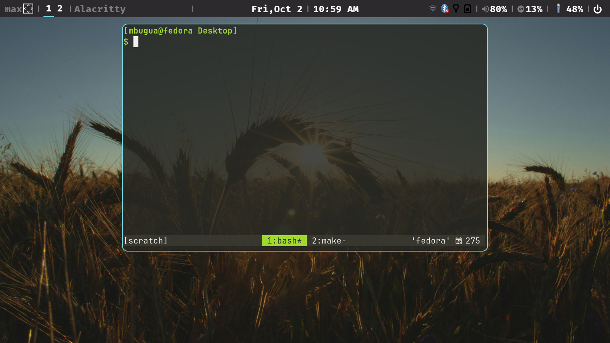

<h1 style="text-align: center;"> ~/.dotfiles </h1>



These are config files important enough for version controll. I use them on my daily driver and they are managed using [stow](https://www.gnu.org/software/stow/).

To get started, run make:

```bash
make help
```
